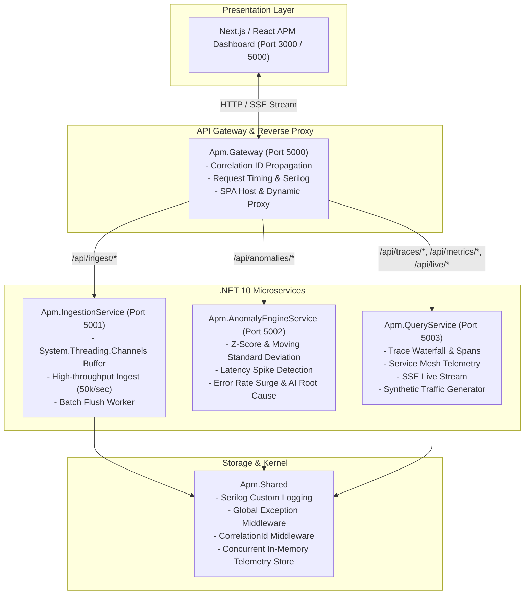

# CloudPulse APM — Distributed Cloud Observability & Anomaly Engine

**CloudPulse APM** is an enterprise-grade Application Performance Monitoring (APM) and statistical anomaly detection platform designed for high-throughput distributed microservice architectures.

Built with **.NET 10 (C# 14)** backend microservices and modern **React / Next.js 15+** real-time dashboards.

---

## 🏛️ Architecture Overview



---

## 🚀 Key Architectural Highlights

### 1. Microservice Architecture
* **`Apm.Gateway` (Port 5000)**: Single entry point reverse-proxying API calls down to the internal microservice cluster, handling graceful degradation if downstream services are temporarily unreachable. Also serves the built-in React Single Page Application.
* **`Apm.IngestionService` (Port 5001)**: Dedicated to receiving telemetry spans, metrics, and logs. Uses non-blocking `System.Threading.Channels.Channel<T>` producer-consumer buffers to handle traffic bursts without tying up HTTP threads.
* **`Apm.AnomalyEngineService` (Port 5002)**: Autonomous statistical analysis engine. Computes rolling means, standard deviations ($\sigma$), and Z-scores on service latencies to detect regressions before outages occur, generating remediation recommendations.
* **`Apm.QueryService` (Port 5003)**: Serves distributed trace searches, span waterfall hierarchies, service health metrics, and Server-Sent Events (SSE) live updates. Includes a traffic simulator to demonstrate healthy traffic, latency spikes, and 500 failure cascades.
* **`Apm.Shared`**: Common class library containing domain models, thread-safe concurrent storage, Serilog configuration, and shared middlewares.
* **`Apm.Dashboard`**: Next.js 15+ App Router application with Tailwind CSS, trace waterfalls, and real-time SSE streaming.

---

### 2. Serilog Structured Logging
Configured uniformly across all services with:
* **Enrichers**: `ServiceName`, `Environment`, `ThreadId`, `CorrelationId` pushed into Serilog's `LogContext`.
* **Sinks**:
  * **Console**: ANSI-colorized formatting: `[{Timestamp:HH:mm:ss} {Level:u3}] [{ServiceName}] [Corr:{CorrelationId}] {Message}`.
  * **File**: Daily rolling log files stored at `logs/{ServiceName}-.log` with 7-day retention.
* **Smart Filtering**: Suppresses chatty framework logs (`Microsoft: Warning`), elevating only application events, slow queries, and anomaly triggers.

---

### 3. Custom ASP.NET Core Middleware Pipeline
1. **`CorrelationIdMiddleware`**:
   * Inspects `X-Correlation-ID` header; generates a new `Guid` if missing.
   * Injects correlation ID into `LogContext.PushProperty("CorrelationId", id)`.
   * Propagates `X-Correlation-ID` into outgoing HTTP response headers and downstream microservice proxies.
2. **`GlobalExceptionHandlingMiddleware`**:
   * Encapsulates execution in `try-catch`.
   * Catches `BadHttpRequestException` (400), `ArgumentException` (400), `KeyNotFoundException` (404), `TimeoutException` (504), and unhandled `Exception` (500).
   * Emits structured Serilog error log with correlation ID, client IP, route, and method.
   * Returns consistent RFC 7807 JSON error responses (`ApiResponse<T>.Fail(...)`).
3. **`RequestLoggingMiddleware`**:
   * Measures pipeline duration with high-resolution `Stopwatch`.
   * Automatically warns (`[SLOW REQUEST DETECTED]`) if request execution exceeds threshold (> 400ms).
4. **`GatewayReverseProxyMiddleware`**:
   * Routes incoming gateway requests dynamically based on URI prefix (`/api/ingest`, `/api/anomalies`, `/api/traces`, `/api/live`).
   * Handles downstream network partitions, connection refusals, and timeouts gracefully with structured fallbacks.

---

### 4. Robust Try-Catch Exception Handling Strategy
* Granular domain validation inside each controller/minimal API endpoint.
* Channel worker loops safeguarded against unhandled exceptions, preventing background worker crashes.
* Thread-safe collection operations guarded with concurrency controls.

---

## 🛠️ How to Run

### Step 1: Build All Microservices
Run the automated build script:
```powershell
.\build.ps1
```

### Step 2: Launch All Microservices
Run the multi-service orchestrator script:
```powershell
.\start-all.ps1
```

This launches:
* 🌐 **Dashboard & API Gateway**: [http://localhost:5000](http://localhost:5000)
* 📥 **Ingestion Service**: [http://localhost:5001](http://localhost:5001)
* 🧠 **Anomaly Engine**: [http://localhost:5002](http://localhost:5002)
* 📊 **Query & Simulator Service**: [http://localhost:5003](http://localhost:5003)

### Step 3: Explore the Features in the Dashboard
1. Open [http://localhost:5000](http://localhost:5000) in your browser.
2. **Microservice Mesh**: View the status, P95 latency, error rates, and total requests for `auth-service`, `order-service`, `payment-gateway`, and `inventory-service`.
3. **Distributed Traces & Waterfall**: Click any trace to inspect the parent-to-child span breakdown and flamegraph timeline.
4. **Simulate Traffic**:
   * Click **🟢 Healthy Traffic** to generate nominal distributed transactions.
   * Click **🟡 Latency Spike (+800ms)** to trigger high latency in payment and order services.
   * Click **🔴 Error Cascade (5xx)** to simulate downstream gateway timeouts and bank authorization errors.
5. **Anomaly Incidents**: Switch to the **Anomaly Incidents** tab to view Z-score deviations (+3.4&sigma;) and automated root cause suggestions, then click **Acknowledge**.
6. **Structured Logs**: View Serilog logs streamed live with correlation IDs.

---

### Step 4 (Optional): Run Standalone Next.js Dashboard
If you want to run the standalone Next.js App Router project:
```powershell
cd src/Apm.Dashboard
npm install
npm run dev
```
Open [http://localhost:3000](http://localhost:3000) (requests are automatically proxied to the Gateway at port 5000).
