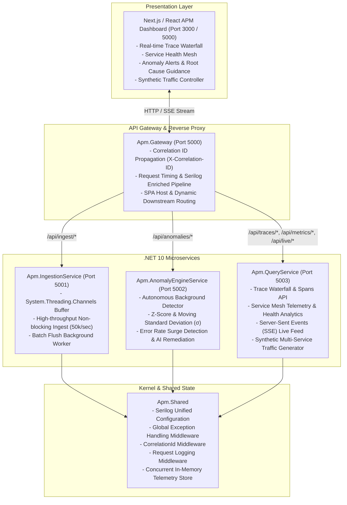

# CloudPulse APM — Distributed Cloud Observability & Anomaly Engine

[](https://dotnet.microsoft.com/)
[](https://docs.microsoft.com/en-us/dotnet/csharp/)
[](https://nextjs.org/)
[](https://react.dev/)
[](https://tailwindcss.com/)
[](https://serilog.net/)

**CloudPulse APM** is an enterprise-grade Application Performance Monitoring (APM) and statistical anomaly detection platform designed for high-throughput distributed microservice systems.

It combines a high-performance **.NET 10 (C# 14)** microservice backend with an interactive **Next.js 15+ / React** observability dashboard, delivering real-time distributed trace waterfall diagrams, statistical latency anomaly detection (Z-score), error rate surge monitoring, and structured Serilog telemetry logging.

---

## 🏛️ Architecture Overview



---

## 📦 Project Structure

```text
CloudPulse-APM/
├── src/
│   ├── Apm.Shared/                      # Shared kernel: Domain models, middlewares, Serilog setup
│   │   ├── Models/                      # TelemetrySpan, MetricDataPoint, AnomalyAlert, etc.
│   │   ├── Middleware/                  # CorrelationId, GlobalExceptionHandling, RequestLogging
│   │   ├── Logging/                     # Unified Serilog builder extensions
│   │   └── Storage/                     # Thread-safe in-memory telemetry store
│   │
│   ├── Apm.Gateway/                     # Port 5000: API Gateway & Reverse Proxy
│   │   ├── Middleware/                  # GatewayReverseProxyMiddleware
│   │   ├── wwwroot/                     # Built-in interactive Single Page Application
│   │   └── Program.cs
│   │
│   ├── Apm.IngestionService/            # Port 5001: High-throughput ingestion microservice
│   │   ├── Services/                    # System.Threading.Channels buffer & batch workers
│   │   └── Program.cs                   # Endpoints: /api/ingest/spans, /api/ingest/metrics, /api/ingest/logs
│   │
│   ├── Apm.AnomalyEngineService/        # Port 5002: Statistical anomaly detection microservice
│   │   ├── Services/                    # Z-score calculator & hosted detector worker
│   │   └── Program.cs                   # Endpoints: /api/anomalies, /api/anomalies/evaluate
│   │
│   ├── Apm.QueryService/                # Port 5003: Analytical query & live stream microservice
│   │   ├── Services/                    # Synthetic traffic & multi-service span generator
│   │   └── Program.cs                   # Endpoints: /api/traces, /api/metrics, /api/live/stream
│   │
│   └── Apm.Dashboard/                   # Port 3000: Next.js 15+ App Router Dashboard
│       ├── app/                         # App Router layout, page, and globals.css
│       ├── lib/                         # TypeScript interfaces & API client definitions
│       └── package.json
│
├── .gitignore                           # Production gitignore for .NET, Next.js, and IDEs
├── build.ps1                            # One-click compile script for all microservices
├── start-all.ps1                        # Multi-service local orchestrator script
├── CloudPulseApm.sln                    # Visual Studio Solution
└── README.md
```

---

## 🚀 Key Architectural Features

### 1. High-Throughput Ingestion via `System.Threading.Channels`
`Apm.IngestionService` decouples HTTP request handling from persistence using bounded in-memory channels (`Channel<TelemetrySpan>`, `Channel<MetricDataPoint>`, `Channel<LogRecord>`). 
* HTTP requests return `202 Accepted` immediately upon writing to the channel.
* A hosted background service (`IngestionBatchWorker`) reads items in batches and flushes them to the data store every 250ms or when batch size exceeds 1,000 items.

### 2. Autonomous Statistical Anomaly Detection
`Apm.AnomalyEngineService` runs a continuous evaluation cycle every 5 seconds:
* **Latency Anomaly (Z-Score)**:
  $$\mu = \frac{1}{N}\sum_{i=1}^N x_i, \quad \sigma = \sqrt{\frac{1}{N}\sum_{i=1}^N (x_i - \mu)^2}, \quad Z = \frac{x_{\text{p95}} - \mu}{\sigma}$$
  When $Z \ge +2.0\sigma$, an incident is flagged with severity (*Warning*, *High*, or *Critical*), accompanied by root-cause remediation guidance.
* **Error Rate Surge**: Automatically flags incidents when error percentages exceed 5% or 15% thresholds.

### 3. Custom ASP.NET Core Middleware Pipeline
1. **`CorrelationIdMiddleware`**:
   * Extracts or generates `X-Correlation-ID`.
   * Enriches Serilog's `LogContext.PushProperty("CorrelationId", id)` for distributed tracing across services.
   * Attaches the header to outgoing responses and forwards it across downstream microservice HTTP calls.
2. **`GlobalExceptionHandlingMiddleware`**:
   * Encapsulates request pipelines in `try-catch`.
   * Catches `BadHttpRequestException` (400), `ArgumentException` (400), `KeyNotFoundException` (404), `TimeoutException` (504), and unhandled exceptions (500).
   * Emits structured Serilog error logs with correlation ID, client IP, route, and method.
   * Returns consistent RFC 7807 JSON error responses (`ApiResponse<T>.Fail(...)`).
3. **`RequestLoggingMiddleware`**:
   * Measures pipeline duration with high-resolution `Stopwatch`.
   * Emits a warning log (`[SLOW REQUEST DETECTED]`) if request execution exceeds 400ms.
4. **`GatewayReverseProxyMiddleware`**:
   * Dynamically forwards `/api/*` calls from the gateway to downstream microservices.
   * Safely handles downstream offline conditions, returning structured 502/504 fallbacks.

### 4. Serilog Structured Logging
* **Console Sink**: ANSI-colored output: `[{Timestamp:HH:mm:ss} {Level:u3}] [{ServiceName}] [Corr:{CorrelationId}] {Message}`.
* **Rolling File Sink**: Automatically writes to `logs/{ServiceName}-.log` with daily rolling and 7-day retention.

---

## 🛠️ Quick Start

### Prerequisites
* [.NET 10 SDK](https://dotnet.microsoft.com/)
* [Node.js 18+](https://nodejs.org/) (optional for standalone Next.js dashboard)
* PowerShell (Windows / macOS / Linux)

### Step 1: Build All Microservices
Run the automated build script:
```powershell
.\build.ps1
```

### Step 2: Launch All Microservices
Run the multi-service orchestrator script:
```powershell
.\start-all.ps1
```

This launches all microservices in parallel:
* 🌐 **API Gateway & Web Dashboard**: [http://localhost:5000](http://localhost:5000)
* 📥 **Ingestion Service**: [http://localhost:5001](http://localhost:5001)
* 🧠 **Anomaly Engine**: [http://localhost:5002](http://localhost:5002)
* 📊 **Query & Analytics Service**: [http://localhost:5003](http://localhost:5003)

### Step 3: Interactive Dashboard Controls
Open [http://localhost:5000](http://localhost:5000) in your browser:
1. **Microservice Mesh**: View status, P95 latency, error rates, and request volumes for `api-gateway`, `order-service`, `payment-gateway`, and `inventory-service`.
2. **Distributed Traces & Waterfall**: Select any trace to view the hierarchical span flamegraph with duration percentages and error attributes.
3. **Simulate Traffic**:
   * Click **🟢 Healthy Traffic** to generate nominal distributed transactions.
   * Click **🟡 Latency Spike (+800ms)** to trigger an anomalous latency spike.
   * Click **🔴 Error Cascade (5xx)** to simulate downstream gateway timeouts and failures.
4. **Anomaly Incidents**: View active Z-score anomalies ($+3.4\sigma$), root-cause analysis, and click **Acknowledge**.
5. **Structured Logs**: Inspect Serilog logs correlated by `TraceId` and `CorrelationId`.

---

### Step 4 (Optional): Run Standalone Next.js Dashboard
If you want to run the standalone Next.js App Router project:
```powershell
cd src/Apm.Dashboard
npm install
npm run dev
```
Open [http://localhost:3000](http://localhost:3000) (requests are automatically proxied to the Gateway at port 5000).

---

## 📄 License
This project is open-source and licensed under the [MIT License](LICENSE).
